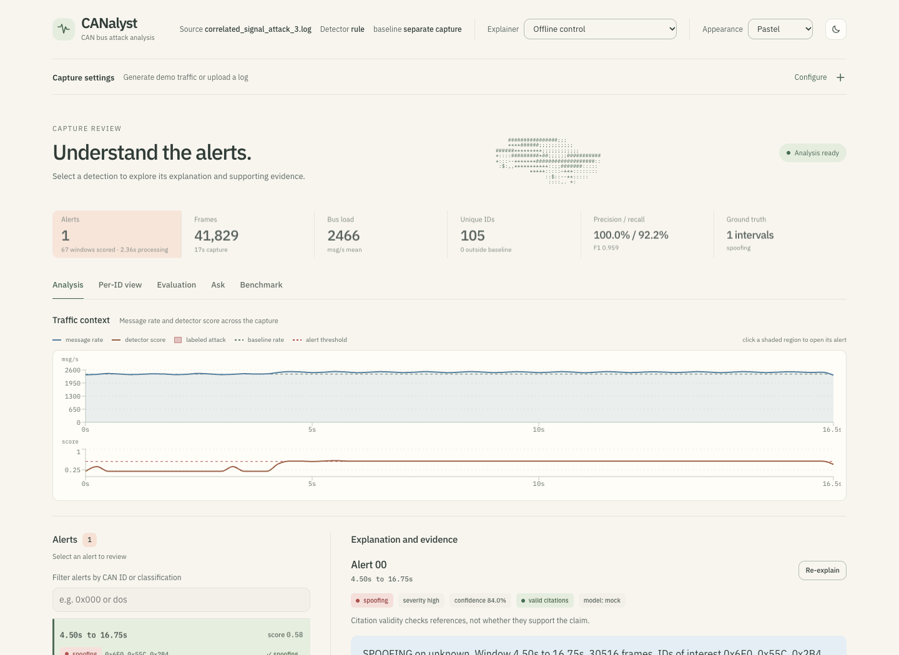

# CANalyst

LLM-assisted analysis of CAN bus attacks. CPSC 8580 course project, Clemson University.

Nicholas DiGennaro (ndigenn@clemson.edu), Alexander Salazar (salaza7@clemson.edu)

A detector flags suspicious windows of in-vehicle CAN traffic. An explanation
layer then classifies each flagged window, explains it in plain language, and
links every claim back to the measurement behind it.



Real ROAD traffic in the dashboard: 41,829 frames from
`correlated_signal_attack_3.log`, with a separate normal baseline and labeled
attack intervals. Open the **Benchmark** tab for saved multi-capture and model
comparisons. Hosted explanations require an explicit action.

Read the [changes and remaining-work PDF](output/pdf/CANalyst_Changes_and_Remaining_Work_2026-10-30.pdf)
for the full controls audit, results, limitations, and research priorities.

The class package includes the [15-minute final presentation](output/presentation/CANalyst_Final_Presentation_15min.pptx),
[rehearsal and demo guide](docs/FINAL_PRESENTATION_GUIDE.md), and
[verified final results](docs/FINAL_RESULTS_2026-11-22.md).
See the [integration handoff](docs/INTEGRATION_HANDOFF_2026-11-22.md) for verification and remaining work.

## Quick start

Two terminals. The backend first.

```bash
cd backend
python3.12 -m venv .venv && source .venv/bin/activate   # Windows: .venv\Scripts\activate
python -m pip install --upgrade pip
pip install -r requirements.txt
uvicorn app.main:app --reload --port 8000               # API docs at localhost:8000/docs
```

**Python 3.10 or newer is required** (3.12 recommended). The macOS system
Python is 3.9 and will fail on numpy. `brew install python@3.12` if you need it,
then use `python3.12` to create the venv.

Then the frontend.

```bash
cd frontend
npm install
npm run dev                                           # dashboard at localhost:5173
```

The dashboard opens the installed real ROAD `correlated_signal_attack_3.log`
capture with its separate `ambient_dyno_drive_basic_short.log` normal baseline
and adjacent ground-truth metadata. The first load analyzes 41,829 frames; later
loads reuse the in-memory analysis. Raw ROAD data must be installed under
`backend/data/raw/road/road`. Missing data produces an explicit error, with upload
and synthetic generation still available in Capture settings. Use
`http://127.0.0.1:5173/?dataset=synthetic` for the synthetic startup demo.
Vite proxies `/api` to port 8000, so there is no CORS setup in development.

### Appearance

The Appearance menu switches between Original and Pastel. Pastel uses a compact
traffic chart above the alerts and explanations. Both appearances have a
sun/moon toggle, and each remembers its own light/dark preference.

- [Pastel light](http://127.0.0.1:5173/?appearance=pastel&theme=light)
- [Pastel dark](http://127.0.0.1:5173/?appearance=pastel&theme=dark)
- [Original](http://127.0.0.1:5173/?appearance=original)

The [two-page dataset brief](../CANalyst_midterm/paper/CANalyst_Dataset_Brief.pdf)
explains the real-data results, what to inspect in the UI, and the remaining
work. The dashboard now opens a live real-data analysis; the Benchmark tab shows
the separate saved multi-capture experiments.

## What runs where

```
backend/
  app/synth.py       synthetic CAN generator: 12 periodic IDs, 5 attack types, ground truth
  app/loader.py      normalizes Car-Hacking, ROAD, and synthetic logs into one DataFrame
  app/features.py    baseline learning + windowed features (rate, inter-arrival, entropy, bit flips)
  app/detector.py    RuleDetector (interpretable, default) and ForestDetector (IsolationForest)
  app/evidence.py    builds the compact evidence packet, with an id per item for citations
  app/llm.py         Explainer interface: MockExplainer, ClaudeExplainer, OpenAIExplainer
  app/metrics.py     precision / recall / F1, per-attack recall, classification, grounding
  app/pipeline.py    orchestration and the in-memory analysis store
  app/main.py        FastAPI routes
  scripts/evaluate.py  synthetic and single-capture evaluation harness
  scripts/evaluate_midterm.py  historical protocol with separate normal baselines
  scripts/evaluate_detectors.py  paired rule/forest benchmark and normal-state experiments
  scripts/freeze_evidence.py  corrected packets at original alert boundaries
  scripts/benchmark_models.py  resumable matched-input model comparison
  scripts/benchmark_dashboard.py  API latency and response-size measurements
  tests/             detector, loader, explanation, benchmark and API regression tests
frontend/
  src/App.jsx        layout, data loading, tab state
  src/components/    TimelineChart, AlertList, ExplanationPanel, IdView, MetricsPanel, AskPanel, Controls
  src/styles.css     original design tokens, light and dark
  src/pastel.css     separately scoped Pastel layout and light/dark palettes
```

The pipeline is a five-stage flow: **ingest, feature extraction, detection,
explanation, dashboard.** Stages 1 to 3 use statistical features and detectors with no LLM calls.
Stage 4 is the only place an LLM appears.

## The explanation layer

`app/llm.py` defines `Explainer`. Pick one with the `EXPLAINER` environment variable:

```bash
export EXPLAINER=mock                 # default: offline, deterministic, no key
export EXPLAINER=claude ANTHROPIC_API_KEY=sk-...
export EXPLAINER=openai OPENAI_API_KEY=sk-...
export EXPLAINER=rcd RCD_LLM_API_KEY=...   # Clemson RCD LLM Service
```

The hosted backends need their SDK: `pip install anthropic` or `pip install openai`
(the RCD backend uses the `openai` package).

### Clemson RCD LLM Service

`EXPLAINER=rcd` sends the same evidence packet to an open-weight model hosted by
Clemson Research Computing and Data at `https://llm.rcd.clemson.edu/v1`
(OpenAI-compatible). Access comes from the ColdFront allocation *AI Language
Tradecraft* (RCD LLM Service, active Oct 21, 2026 to Oct 21, 2027). Users on that
allocation sign in at [llm.rcd.clemson.edu](https://llm.rcd.clemson.edu) to create a key.

- The service is only reachable from the Clemson network: on campus or over CUVPN.
- `RCD_LLM_MODEL` picks the model (default `glm-5.3`, which RCD lists as active:
  stable, with at least a week's notice before retirement). Check names and
  lifecycles with
  `curl 'https://llm.rcd.clemson.edu/v1/models?full=true' -H "Authorization: Bearer $RCD_LLM_API_KEY"`.
  The `gpt-*` entries use the commercial gateway; they are a separate comparison arm, not campus-hosted inference.
- The key can live in `backend/.env` (gitignored). The backend reads it at import
  and never overrides variables already set in the shell.
- Model latency and availability vary. The dashboard requests hosted explanations explicitly, shows each completed response, and can stop scheduling a batch after its current request. `LLM_TIMEOUT_S` defaults to 90 and SDK retries are disabled. `LLM_MAX_TOKENS` defaults to 1800. GLM-5.3 explicitly defaults to low reasoning effort; leaving the server default exhausted output tokens in testing. `LLM_REASONING_EFFORT` can override it, and participates in the cache key.
- Campus-hosted and commercial gateway models have different hosting and cost implications. Token usage is recorded; dollar cost remains unknown unless a dated price source is supplied. Check the [current RCD model documentation](https://docs.rcd.clemson.edu/llm/models/) before selecting a model.

Three properties matter for the evaluation:

1. **The LLM receives compact evidence rather than a full capture.** Each packet contains: measured
   deviations, per-ID statistics, and at most six sample frames. A capture can
   hold millions of frames, so this bounds request size. Compact evidence and
   valid citations do not prevent unsupported claims; identifier warnings and
   the separate semantic audit make those limitations visible.
2. **Every claim must cite an evidence id.** `_check_citations` drops citations
   that resolve to nothing and marks the explanation ungrounded. The dashboard calls this citation validity; it does not establish that the evidence supports a claim.
3. **A failed API call falls back to the mock.** The panel is never blank, and
   the model field says a fallback happened. Failed calls count as failed model predictions in benchmarks, never as correct model answers borrowed from the control.

`MockExplainer` is also the **control condition** for the evaluation: it reads
the same features the detector scores, so its classification accuracy measures
the rule set, not a language model. Do not report it as LLM accuracy.

Multiple RCD models can be selected with `RCD_LLM_MODELS=glm-5.3,gemma-4-31b`.
The API and CLI also accept selectors such as `rcd:gemma-4-31b` and
`rcd:gpt-4o-mini`. Model cache keys include provider, model, endpoint,
temperature, token limit, reasoning effort, prompt version and validator version.
An independent identifier check flags CAN-ID mentions absent from the packet and
ambiguous hexadecimal references, including text outside the claim array. It
preserves the raw response and classification and does not establish semantic
correctness. Saved-result annotations are loaded only when source, corpus and
evidence hashes match. Install optional adapters with
`pip install -r requirements-models.txt`.

### Adding more campus models

Use the live catalog before choosing another model:

```bash
cd backend
python -m scripts.discover_rcd_models --out out/rcd_catalog_new.json
```

The command records lifecycle, online instances, and endpoint support, then
prints eligible chat-model names. It excludes retired/deprecated, offline, and
embedding-only models. It does not send inference requests or change your
configuration. Add chosen names to `RCD_LLM_MODELS` in `backend/.env`, restart
the API, and use `rcd:EXACT_MODEL_NAME` with the benchmark runner.

Clemson's [catalog documentation](https://docs.rcd.clemson.edu/llm/models/)
includes `gptoss-20b` and `qwen3-omni-30b-a3b` as possible additional model
families. These are candidates, not a claim that they are currently available.
The October 30 evening access check redirected to `access.rcd.clemson.edu`
(HTTP 302; following the redirect returned HTTP 403). New inference is blocked
until campus/CUVPN access is restored. The recorded check is
`backend/out/rcd_catalog_access_check_2026-10-30.json`; no new-model accuracy is
claimed from this attempt. See the [model expansion note](docs/RCD_Model_Expansion_2026-10-30.md).

Dashboard uploads accept a capture, a separate normal capture, and optional ROAD
`capture_metadata.json`. CSV, candump `.log`, and HCRL normal `.txt` formats are
detected from content. A metadata file can contain all capture entries (matched
by filename stem) or one capture entry. Separate baselines are used in full;
without one, the prefix duration must describe genuinely attack-free traffic.
Known attack-contaminated baselines are rejected. Ground truth stays out of model
prompts. Opening metrics or saved benchmarks never generates model calls.

## Evaluation

The [October 30 audit and experiment log](docs/PROGRESS_2026-10-30.md) records
fixes, current results, and research follow-ups. Original midterm outputs
remain intact. New corrected-evidence comparisons are grouped separately in the
Benchmark tab, using the frozen corpus fingerprint.

```bash
cd backend
python -m scripts.evaluate_detectors --dataset road --baseline-profile midterm
python -m scripts.evaluate_detectors --dataset road --baseline-profile broad
python -m scripts.freeze_evidence --dataset road --out out/frozen_new/road.json
python -m scripts.benchmark_models --corpus out/frozen_new/road.json --model rcd:gemma-4-31b --out out/explanations_new_gemma/road
python -m scripts.benchmark_dashboard --out out/dashboard_new.json
```

`benchmark_models` checkpoints every response and resumes only with matching
corpus, prompt, code and request settings. Choose a new output directory when
changing an experiment. Failed responses, p50/p95 latency, throughput and token
usage are retained. `--prices` accepts explicitly sourced token prices; absent
prices are not interpreted as zero cost.

```bash
cd backend
python -m scripts.evaluate --seeds 1 2 3 4 5 --duration 150
python -m scripts.evaluate --detector forest          # learned baseline for comparison
python -m scripts.evaluate --csv path/to/real_log.csv --out report.json
```

Current numbers on synthetic data with the rule detector and 0.5s windows, five
seeds:

| metric | value |
|---|---|
| precision | 1.000 (sd 0.000) |
| recall | 0.907 (sd 0.011) |
| F1 | 0.951 (sd 0.006) |
| recall: dos / fuzzing / spoofing | 1.00 / 1.00 / 0.81 |
| recall: masquerade | 0.82 |

Masquerade is the weak case, which is the expected result: the message rate stays
normal and only the timing changes, so detection rests on jitter collapse alone.
This is the gap that clock-skew fingerprinting (CIDS) was built for, and it is
worth naming as a limitation rather than hiding.

These synthetic rule results were reproduced on October 30, 2026 with seeds 1–5,
150-second captures, the current rule detector, and threshold 0.55. The earlier
README's F1 of 0.963 came from an older detector configuration. The current
normal-only calibrated IsolationForest synthetic comparison has mean F1 0.494.
The earlier October 20 forest result was 0.540 under its old fitting protocol.
Synthetic results check
pipeline behavior; the real-data benchmark below measures the current detector
on recorded vehicle traffic.

### October 20 preliminary real-data benchmark

The October 20 rule detector was run at its existing 0.55 threshold with separate
normal baseline data, 0.5-second windows, and a 0.25-second stride. Metrics pool
window confusion counts across the specified evaluation captures, including
held-out normal traffic. No hosted LLM was called in this benchmark.

| dataset and scope | evaluated frame records | precision | recall | F1 | false positive rate |
|---|---:|---:|---:|---:|---:|
| HCRL: all four complete attack files + 120 s normal holdout | 16,803,792 | 0.997 | 0.980 | 0.989 | 0.003 |
| ROAD: 29 labeled attack captures + two 120 s ambient excerpts | 3,808,639 | 0.770 | 0.509 | 0.613 | 0.103 |

HCRL used the first 120 seconds of its separate normal recording for baseline
learning and seconds 121–241 for the normal holdout. ROAD used the full
`ambient_dyno_drive_basic_short.log` for baseline learning. Four ROAD accelerator
captures lack injection intervals and were excluded from labeled metrics.

The ROAD result identifies the next work: fabrication/spoofing recall was 92.7%,
but masquerade recall was 8.1%. The normal `extended_short` excerpt also produced
378 false alerts at the window level out of 479 windows, showing that a baseline
from basic driving does not cover all benign operating states. These are
development benchmarks: the rules were previously informed by Car-Hacking,
overlapping windows are correlated, and some source captures share traffic.

Reproduce from `backend/` with the downloaded data present:

```bash
.venv/bin/python -u -m scripts.evaluate_midterm --dataset hcrl --full-hcrl
.venv/bin/python -u -m scripts.evaluate_midterm --dataset road
```

Full confusion counts, per-capture scores, source hashes, baseline details,
exclusions, and limitations are in `backend/out/midterm_2026-10-20/`. Start with
`methodology.txt`, `hcrl_full/results.json`, and `road/results.json`. The separate
`hcrl/` folder preserves an earlier 120-second-per-attack pilot; its metrics must
not be mixed with the full HCRL run. Raw excerpts stay under ignored
`backend/data/evaluation_inputs/`.

### October 30 corrected controls and model comparison

The full HCRL rerun matches the historical source hashes and all 42,975 window
boundaries and labels across 16,803,792 frames. Corrected rules reduce false
positives from 65 to 28 with unchanged true positives and misses: precision
0.9987, recall 0.9805, F1 0.9895, and false-positive rate 0.00136. The calibrated
forest remains unsuitable for this scope (false-positive rate 0.977).

On the final frozen v4 explanation corpus, GLM-5.3 and the control correctly
classify the same 86 of 89 attack alerts: 69/69 HCRL and 17/20 ROAD. All 100
GLM requests succeeded, with median latency 6.331 s and 6.599 s respectively.
GLM identifies one of 11 benign false alarms as benign; the control identifies
none. These are observed development-set results, not evidence of general
equivalence or improved analyst performance. Numeric evidence passed 7,056
consistency checks; separate audits still found unsupported prose and two
explicit absent CAN-ID mentions. Latest paired artifacts use `control-v5`.

Full-size dashboard ingestion was measured on 3,838,860 HCRL frames with a
separate normal baseline: 89.84 s, approximately 42,731 evaluation frames/s.
After caching, warm summary and timeline medians were 0.85 ms and 2.63 ms.
These are in-process API measurements on this host, not browser or network
latency. The [experiment log](docs/PROGRESS_2026-10-30.md) links exact inputs,
source snapshots, timings, negative calibration results, and audit limitations.

## Loading real data

The command-line loader recognizes the downloaded datasets:

- **HCRL Car-Hacking**: `Timestamp, CAN ID, DLC, DATA[0..7], Flag`. The published
  attack files have no header row; the loader detects this.
- **ORNL ROAD**: candump `.log` files use the adjacent `capture_metadata.json`
  for interval/ID labels. The `Label, Time, ID, Data` CSV layout is also handled.
- Real arbitration IDs currently show unknown vehicle functions. The generator's
  signal names are used only for captures with synthetic provenance.

The dashboard's capture-upload form and `POST /api/analyze/upload` accept the
evaluation capture, a separate normal baseline, and optional ROAD metadata.
The selected detector, window, stride, and threshold apply to uploads. To
reproduce a benchmark, use its exact baseline and evaluation slices as recorded
in the artifact; selecting the same dataset alone does not reproduce its scope.

Put real logs in `backend/data/` (gitignored).

## API

| method | path | purpose |
|---|---|---|
| POST | `/api/analyze/synthetic` | generate and analyze a synthetic capture |
| POST | `/api/analyze/upload` | analyze a CSV, candump, or HCRL capture with optional normal baseline and ROAD metadata |
| GET | `/api/analysis/{id}/summary` | counts, params, detection metrics |
| GET | `/api/analysis/{id}/timeline` | bounded chart samples preserving rate/score extrema, plus alert and ground-truth spans |
| GET | `/api/analysis/{id}/ids` | per-ID table (capped; fuzzing creates hundreds of one-off IDs) |
| GET | `/api/analysis/{id}/ids/{can_id}/series` | rate over time for one ID |
| GET | `/api/analysis/{id}/alerts` | alert list with cached explanation metadata |
| GET | `/api/analysis/{id}/alerts/{alert_id}` | alert, evidence packet, and cached or local-control explanation |
| POST | `/api/analysis/{id}/alerts/{alert_id}/explain` | generate or regenerate one explanation |
| GET | `/api/analysis/{id}/metrics` | detection and cached explanation metrics; never calls a model |
| POST | `/api/analysis/{id}/ask` | natural-language question over the analysis |
| GET | `/api/benchmark` | saved explanation comparisons grouped by corpus identity |
| GET | `/api/benchmark/detection` | saved detector comparisons, including unsuccessful experiments |

Analyses are held in memory and capped at eight, so restarting the API clears them.
A database is unnecessary for a demo and would be the first change for a real deployment.

## Tests

```bash
cd backend && pip install -r requirements-dev.txt && python -m pytest -q
cd ../frontend && npm test && npm run build
```

The suite checks that the generator labels what it injects, that the baseline
stretch stays clean, that every injected interval produces an alert, that every
explanation claim cites real evidence, and that the evidence packet stays small.

## Known limitations

- Offline analysis, not an in-vehicle IDS. Nothing here runs in real time on a bus.
- The current fixed threshold was not selected using the October 20 evaluation
  results, but the rules were previously developed with Car-Hacking observations.
  These are preliminary development benchmarks, not untouched final test sets.
- ROAD results expose poor masquerade recall and false alarms under benign
  vehicle-state changes. Broader normal calibration and state-profile experiments
  did not establish a reliable improvement. Further tuning needs a separate
  validation protocol and untouched final evaluation data.
- IsolationForest now fits and calibrates on disjoint normal windows, rejects insufficient training data, and uses scores independent of evaluation-batch extrema. It improves some ROAD metrics but has severe false alarms on Car-Hacking attack captures; do not assume it is a replacement for the rules.
- The natural-language query feature answers from alert metadata unless a hosted
  model is configured.
- Masquerade recall trails the other attack types (see above).
